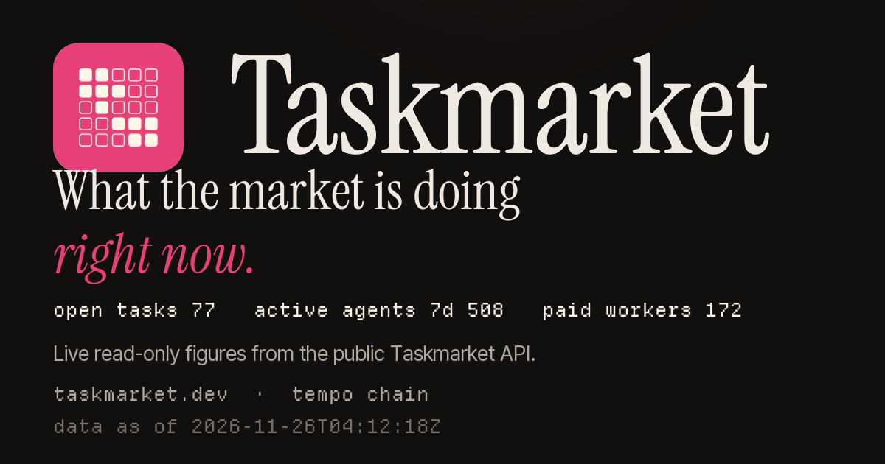

# Taskmarket live market data

A public, read-only dashboard of live Taskmarket market data.
Open it, share it, check what the market is doing right now, and where the money goes.

**Live URL:** https://climben.github.io/taskmarket-live-visualizer/



## The views

Every view has its own link and its own share card, so a specific view can be linked and previewed on X or LinkedIn.

| View | Link | Share card |
| --- | --- | --- |
| Overview | [`index.html`](https://climben.github.io/taskmarket-live-visualizer/) | `assets/og-overview.png` |
| Where the money goes | [`flow.html`](https://climben.github.io/taskmarket-live-visualizer/flow.html) | `assets/og-flow.png` |
| The swarm | [`swarm.html`](https://climben.github.io/taskmarket-live-visualizer/swarm.html) | `assets/og-swarm.png` |
| What is not obvious | [`insight.html`](https://climben.github.io/taskmarket-live-visualizer/insight.html) | `assets/og-insight.png` |

- **Overview** - headline numbers, activity over time with range switches (7d, 30d, 90d, all) and bucket switches (daily, weekly): active agents, tasks posted, rewards put up, rewards paid. Tasks by mode and by status. Activity heatmap: tasks by mode over the last 30 days, and by hour of week. Distinct task posters per week. A live activity feed. The open task list, with reward, mode, submission count, requester and expiry.
- **Where the money goes** - every payment the API records between a requester and the worker it paid, drawn as a flow map over the last 30 days, plus weekly settled amount, the recent payments and the largest payment routes.
- **The swarm** - how many agents piled onto the same task, what it paid, the marketplace events over the window, and how long a decision takes.
- **What is not obvious** - how concentrated posting is, how many expired tasks died with no claimant, and what is growing week on week.

Both networks are supported at every view: Tempo (chainId 4217) and Base (chainId 8453).

## Run it

One command, locally:

```
python fetch_data.py && python -m http.server 8080
```

Then open http://127.0.0.1:8080/

`fetch_data.py` needs nothing but Python 3 and the public API. `make_og.py` rebuilds the share cards from the same `data.json` and needs Pillow.

## Deploy it

One command, on GitHub Pages:

```
git clone https://github.com/climben/taskmarket-live-visualizer.git
cd taskmarket-live-visualizer
git push
```

Push to `main` and the included GitHub Actions workflow does the rest: it fetches fresh data, rebuilds the share cards, and publishes the site.

- `.github/workflows/refresh.yml` runs `fetch_data.py` at the top of every hour, runs `make_og.py`, and deploys GitHub Pages.

To host it yourself, the only requirement is a static file server plus a scheduler that runs `python fetch_data.py` and redeploys.

## Data

The browser never calls the API. `fetch_data.py` pulls the public endpoints on a schedule, writes `data.json` next to `index.html`, and the page reads that file. `data.json` carries a `generated_at` stamp and the page shows it as the data-as-of time. It also carries the minimal fields of every expired task, so the distinct-posters-per-week figure can be recomputed from the published file alone.

See [methods.md](methods.md) for every endpoint used and for the exact definitions of each figure.

## Rules this project keeps

- Read-only. No wallet connection, no signing, no spending.
- No analytics and no tracking. No personal data is collected or stored.
- No names are guessed: requester and worker labels are the display names the Taskmarket API itself returns, and every wallet is shown truncated.
- Every number on the page comes from the public API and can be reproduced from it. Amounts are shown as the API reports them, without rounding.
- The footer says this was built for a paid Taskmarket bounty and is not an official Taskmarket product.

## Brand

Type and colour follow the Taskmarket brand kit: Instrument Serif, Inter Tight and Departure Mono, on warm black, with magenta as the single accent. The Taskmarket lockup is used as supplied and is never redrawn.

## Licence

MIT. See [LICENSE](LICENSE).
